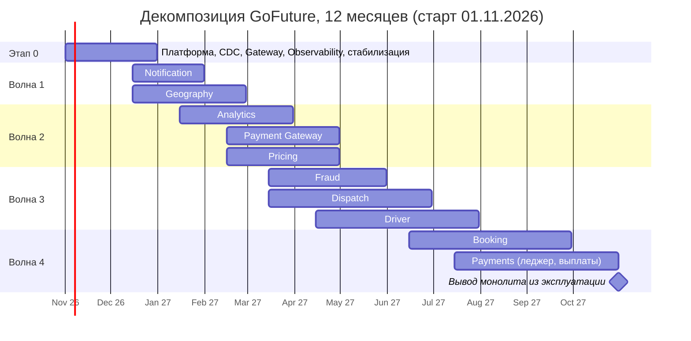

# Task1. Проектируем домены: декомпозиция монолита GoFuture

**Автор:** Михаил К.
**Дата:** 21.10.2026
**Статус:** предложено

Артефакты задания:

| Артефакт | Файл |
|:--|:--|
| Нефункциональные требования | [ADR 1.1](#adr-11-нефункциональные-требования) |
| Карта сервисов и доменные границы | [ADR 1.2](#adr-12-карта-сервисов-и-доменные-границы) |
| Очерёдность выделения сервисов | [ADR 1.3](#adr-13-очерёдность-выделения-сервисов) |
| Диаграмма C2 To-Be | [C2_ToBe.puml](C2_ToBe.puml) / [C2_ToBe.png](C2_ToBe.png) |
| Обратная совместимость | [ADR 1.4](#adr-14-механизмы-обратной-совместимости) |
| План миграции данных | [ADR 1.5](#adr-15-план-миграции-данных) |
| Дорожная карта на год | [ADR 1.6](#adr-16-дорожная-карта-на-12-месяцев) |

## Допущения

В кейсе нет ряда цифр, без которых нельзя оценить нагрузку и сроки. Ниже мои допущения. Их нужно подтвердить замерами на проде до начала Этапа 0.

| № | Допущение | Откуда взято |
|:-:|:--|:--|
| A1 | Средняя длительность поездки 20 минут. Значит, 500 тыс. конкурентных поездок это около 420 новых поездок в секунду | Допущение |
| A2 | Позиция водителя шлётся раз в 4 секунды. На линии 650 тыс. водителей (500 тыс. в поездке и около 150 тыс. свободных). Это около 160 тыс. событий геопозиции в секунду на пике | Расчёт из A1 |
| A3 | Сейчас монолит держит до 100 тыс. поездок и падает каскадно (из кейса) | Кейс |
| A4 | Основная БД монолита: порядка 10 ТБ, из них около 70% приходится на поездки и геотреки. Горячие данные (последние 90 дней) составляют менее 15% объёма | Допущение, нужен замер |
| A5 | Облако: в кейсе указаны одновременно Yandex Cloud, EC2 и AWS ELB. Принимаю Kubernetes и Terraform, не привязанные к вендору (подробнее в Task3) | Противоречие в кейсе |
| A6 | Платёжные и картографические провайдеры в новых регионах меняются на локальные. Для этого нужна абстракция провайдера | Бизнес-требование кейса |

## ADR 1.1. Нефункциональные требования

### Контекст

Монолит на Django держит единую БД и очереди RabbitMQ. На пике более 100 тыс. поездок он даёт каскадные отказы, MTTR выше 4 часов, сборка идёт 30+ минут, вертикальное масштабирование выполняется вручную по алертам. От целевой архитектуры ждут 500 тыс. конкурентных поездок, выход на рынки Юго-Восточной Азии и Южной Америки, 99,95% доступности и вывод фичи на рынок за 2 недели.

### Требования

Нужен проверяемый список NFR с числами, по которому можно принимать архитектурные решения и проверять результат.

### Решение

Сервисы делятся на два уровня критичности.

- **Tier-0 (критический путь заказа):** Booking, Dispatch, Driver (статусы и локация), Geography (приём локаций), Pricing (котировка), Payments (авторизация).
- **Tier-1 (деградация допустима):** Notification, Analytics, Fraud (при недоступности работает правило fail-open с лимитом суммы), админ-панель, выплаты.

| ID | Категория | Требование | Метрика проверки |
|:-:|:--|:--|:--|
| NFR-01 | Нагрузка | 500 тыс. конкурентных поездок, около 420 новых заказов/с (A1) | Нагрузочный тест, 125% от целевого значения |
| NFR-02 | Нагрузка | Приём 160 тыс. событий геопозиции/с (A2) на всех регионах суммарно | Kafka ingest, lag менее 5 с |
| NFR-03 | Доступность | Tier-0: 99,99% (в Task3 заказчик называет 99,99%, в бизнес-требованиях 99,95%, берём большее). Tier-1: 99,95% | SLO по успешным запросам, окно 30 дней |
| NFR-04 | Латентность | Создание заказа p99 менее 500 мс. Котировка цены p99 менее 200 мс | Метрики API Gateway |
| NFR-05 | Латентность | Подбор водителя: от заказа до первого оффера p95 менее 3 с | Событие BookingCreated до DriverOfferSent |
| NFR-06 | Свежесть данных | Геопозиция доступна для поиска в индексе менее чем через 1 с (p99). Surge-коэффициент ячейки обновляется каждые 10 с | Event-time lag |
| NFR-07 | Восстановление | MTTR не более 15 мин для Tier-0 (на промежуточном этапе из кейса 1 час). RTO региона 5 мин, RPO не более 5 с (подробнее в Task3) | Учения и инциденты |
| NFR-08 | Масштабирование | Автоскейлинг в Kubernetes (HPA/KEDA по RPS и lag Kafka). Добавление реплик не более 2 мин. Ручное масштабирование исключено | Хаос-тесты, нагрузочные тесты |
| NFR-09 | Скорость поставки | Сборка и тесты одного сервиса менее 5 мин. Деплой сервиса независим от остальных. Выход фичи на рынок не более 2 недель (lead time) | DORA-метрики |
| NFR-10 | Изоляция отказов | Падение любого Tier-1 сервиса не ломает создание заказа. Circuit breaker, таймауты и bulkhead на каждом синхронном вызове | Тесты отказов (chaos) |
| NFR-11 | Согласованность | Деньги: строгая согласованность внутри Payments, между сервисами итоговая (saga + идемпотентность). Потеря событий недопустима для заказов и платежей | Сверка леджера |
| NFR-12 | Наблюдаемость | 100% критических метрик и алертов покрыто (промежуточная цель кейса). Сквозная трассировка запроса от шлюза | Каталог SLI/SLO |
| NFR-13 | Безопасность | Единая аутентификация через IAM, mTLS между сервисами, секреты в Vault, карточные данные не хранятся (токенизация у провайдера) | Аудит, pentest |
| NFR-14 | Комплаенс | Данные граждан хранятся и обрабатываются в регионе проживания (Task3) | Реестр данных, аудит |
| NFR-15 | Мультитенантность | Партнёр запускается без изменения кода платформы, данные изолированы (Task5) | Время онбординга |
| NFR-16 | Стоимость | Минус 40% затрат на ресурсы за счёт автоскейлинга (цель из кейса) | FinOps-отчёт |
| NFR-17 | Совместимость | Старые версии мобильных приложений продолжают работать минимум 12 месяцев. Простой при миграции равен нулю | Доля трафика на v1 |
| NFR-18 | Эксплуатация | Каждый сервис описан контрактом (OpenAPI или AsyncAPI), имеет runbook, SLO и владельца | Чек-лист готовности к проду |

### Альтернативы

Единый SLO 99,95% на все сервисы. Отвергнуто: для Tier-1 это завышает стоимость (кросс-региональный active-active для аналитики не оправдан), а для Tier-0 не хватает запаса.

### Компромиссы и риски

- 99,99% Tier-0 допускает 52 минуты простоя в год. Достижимо только при multi-region active-active и автоматическом failover (Task3). Один регион даёт потолок около 99,95%.
- Значения NFR-01, 02, 05 построены на допущениях A1 и A2. Если средняя поездка окажется 12 минут, а не 20, нагрузка вырастет в 1,7 раза. Нужна проверка на реальных данных до проектирования ёмкости.
- Fail-open в Fraud снижает риск простоя, но повышает риск мошенничества на время деградации. Принимается ради доступности, с лимитом суммы и постфактум-проверкой.

## ADR 1.2. Карта сервисов и доменные границы

### Контекст

В компании 8 продуктовых команд по доменам, платформенная команда, SRE и data-инженеры. Закон Конвея: границы сервисов должны совпадать с границами команд, иначе сквозные изменения вернут срок выхода фичи к полугоду.

### Требования

Один сервис принадлежит одной команде и владеет своими данными. Границы строятся по доменам, а не по слоям (UI, API, БД).

### Решение

Каждая из 8 продуктовых команд получает один домен и один основной сервис. Две точки отличаются: у команды Driver два сервиса (Driver и Dispatch), потому что подбор водителя нагружается и масштабируется иначе, чем профили. Ещё добавляются платформенные компоненты. Всё показано на [C2_ToBe.puml](C2_ToBe.puml).

| Сервис | Команда | Владеет данными | Ответственность | Хранилище | Критичность |
|:--|:--|:--|:--|:--|:-:|
| Booking | Booking | Заказы, поездки, статусы | Жизненный цикл поездки, оркестратор саги бронирования | PostgreSQL | Tier-0 |
| Driver | Driver | Профили, документы, статусы водителей | Регистрация, доступность, рейтинг | PostgreSQL | Tier-0 |
| Dispatch | Driver | Офферы, очередь заказов, состояние подбора | Подбор водителя с отложенным назначением, антигорячие зоны | Redis + события Kafka | Tier-0 |
| Pricing | Pricing | Тарифы, правила, surge по ячейкам | Котировка цены, динамическое ценообразование | PostgreSQL + Redis | Tier-0 |
| Payments | Payments | Платежи, леджер, выплаты | Авторизация, capture, возвраты, выплаты, сверка | PostgreSQL | Tier-0 |
| Notification | Notification | Шаблоны, токены устройств, статусы доставки | Push (FCM, APNS, Huawei), SMS, email | PostgreSQL | Tier-1 |
| Geography | Geography | Геопозиции, гео-индекс | Приём локаций, поиск кандидатов, маршруты | Redis (H3-ячейки) | Tier-0 |
| Analytics | Analytics | Витрины и агрегаты | Потоковая и пакетная аналитика | ClickHouse | Tier-1 |
| Fraud | Fraud | Скоринг и решения | Оценка заказов и платежей в реальном времени | Redis (признаки) | Tier-1 |
| IAM, API Gateway, Observability, CI/CD | Платформа | Идентичность, маршруты, телеметрия | Сквозные возможности | Keycloak, Prometheus и др. | Tier-0 |

Принципы границ:

1. **База данных на сервис.** Прямые запросы в чужую БД запрещены. Общение только через API (gRPC или REST) и события Kafka.
2. **Синхронно только там, где ответ нужен немедленно:** Booking вызывает Pricing (котировка) и Fraud (проверка), Dispatch вызывает Geography (кандидаты). Остальное идёт через события.
3. **Стек.** Python и Django-компетенции команд сохраняются (FastAPI для новых сервисов): переписывание на другой язык отодвинуло бы срок на месяцы, а цель это 2 недели. Go только там, где нужна высокая пропускная способность: Geography (160 тыс. событий/с) и Dispatch.
4. **Распределённые транзакции** между Booking, Payments, Pricing и Fraud выполняются сагой (Task2). Двухфазные коммиты не используются.

### Альтернативы

- **Один сервис на каждый уровень (UI, бизнес-логика, данные).** Отвергнуто: любая фича затрагивает все слои и все команды.
- **Более мелкие сервисы (наносервисы, например отдельный Rating, Document Verification).** Отвергнуто на старте: рост числа сетевых вызовов и операционной нагрузки при 8 командах. Возможно позже, когда у домена появится собственная команда.
- **Модульный монолит вместо микросервисов.** Хорошо решает скорость сборки и границы кода, но не решает масштабирование по регионам и каскадные отказы по общему рантайму и БД. Принимается как промежуточный шаг внутри Этапа 0 (разделение кода монолита по доменам и PostgreSQL-схемам), а не как цель.

### Компромиссы и риски

- Появляются сетевые вызовы и задержки там, где раньше были вызовы функций. Закрывается таймаутами, повторами с backoff и circuit breaker.
- Общие сущности (поездка, пользователь) нужны сразу нескольким доменам. Каждый домен хранит только свою проекцию (id плюс нужные поля), источник истины один. Риск устаревания проекций закрывается событиями и сверкой.
- Dispatch и Geography на Go означают второй стек в компании. Требуется поддержка платформенной команды (общие шаблоны сервисов, библиотеки).

## ADR 1.3. Очерёдность выделения сервисов

### Контекст

Нельзя выделять всё сразу: у монолита общая БД, а команды одновременно развивают продукт. Нужен порядок, который сначала снижает риск сбоев и даёт быстрые результаты (через 2 месяца: инциденты минус 70%, MTTR 1 час, сборка 15 минут), а самые рискованные домены откладывает на момент, когда платформа отработана.

### Требования

Очерёдность должна быть обоснована измеримыми критериями, а не вкусом. Каждый этап даёт самостоятельную пользу.

### Решение

Критерии оценки (1 = легко или низкий риск, 5 = тяжело или высокий риск; для «Ценности» 5 = максимум пользы):

| Критерий | Смысл |
|:--|:--|
| Ценность | Насколько снимает боль монолита (нагрузка, отказы) и открывает бизнес-цели |
| Связность | Сколько зависимостей от других доменов и таблиц в общей БД |
| Данные | Сложность и объём миграции данных |
| Риск | Цена ошибки для бизнеса (деньги, потеря заказов) |

| Порядок | Сервис | Ценность | Связность | Данные | Риск | Обоснование |
|:-:|:--|:-:|:-:|:-:|:-:|:--|
| 0 | Платформа (K8s, Kafka, CDC, Gateway, Observability, CI/CD) | 5 | 1 | 1 | 1 | Без неё остальное невозможно. Сама по себе даёт часть результата Этапа 0: рост наблюдаемости и ускорение сборки |
| 1 | Notification | 2 | 1 | 1 | 1 | Листовой сервис, только потребляет события, критичного состояния нет. Идеальный пробный выпуск платформы |
| 2 | Geography | 5 | 2 | 1 | 2 | Главный источник нагрузки (160 тыс. событий/с), данные эфемерные (TTL), миграция не нужна. Сразу убирает основную причину каскадных отказов |
| 3 | Analytics | 3 | 1 | 3 | 1 | Только читает через CDC, не влияет на поток заказа. Нужен как база для ML (Task4) и для измерения прогресса миграции |
| 4 | Payment Gateway (адаптеры PSP) | 4 | 2 | 1 | 3 | Только внешние вызовы провайдеров, без переноса данных. Нужен для новых регионов (локальные платежи). Леджер остаётся в монолите |
| 5 | Pricing | 5 | 2 | 2 | 3 | Динамическое ценообразование это бизнес-цель. Входные данные (спрос, предложение) доступны из событий. Читает конфигурацию, пишет в основном кэш |
| 6 | Fraud | 3 | 2 | 2 | 2 | Работает асинхронно, сначала в shadow-режиме (не блокирует), поэтому безопасен для проверки модели |
| 7 | Dispatch и Driver | 5 | 3 | 3 | 4 | Умное распределение водителей это отдельная бизнес-цель. Dispatch создаётся как новый сервис поверх Geography и событий, а Driver мигрирует следом |
| 8 | Booking | 5 | 5 | 5 | 5 | Ядро, связано со всем. Выделяется после того, как зависимости вынесены и платформа проверена |
| 9 | Payments (леджер и выплаты) | 4 | 4 | 5 | 5 | Деньги и регуляторика: ошибка недопустима. Мигрирует последним, с параллельной сверкой |

Правила очерёдности:

1. **Сначала листья и эфемерное**, потом ядро. Первые выпуски проверяют платформу, а не бизнес-логику.
2. **Сначала события, потом данные.** Сервис, которому нужны данные монолита, сначала получает их через CDC, и только потом забирает владение.
3. **Новые возможности строятся сразу в новых сервисах** (динамический surge, антигорячие зоны, мультитенантность), а не в монолите. Иначе монолит продолжит расти.
4. **Максимум две волны параллельно**, чтобы не перегрузить платформенную команду и SRE.
5. **Критерий готовности следующего шага:** SLO предыдущего выполнены две недели подряд, откат отработан.

### Альтернативы

- **Начать с Booking как самого болезненного.** Отвергнуто: максимальный риск при немаксимальной готовности платформы. Ядро без отлаженного CDC, шлюза и наблюдаемости рискует сорвать бизнес.
- **Big bang (разом, с остановкой на выходные).** Отвергнуто: цель простоя ноль, откат практически невозможен, срок и риск не предсказуемы.
- **Порядок по командам (кто готов).** Отвергнут как единственный критерий: снимает организационные трения, но не учитывает нагрузку и риск. Готовность команд используется как поправка внутри волны.

### Компромиссы и риски

- Платёжные данные мигрируют последними, поэтому на протяжении 10 месяцев деньги остаются в монолите, который нестабилен. Смягчение: Payments сразу получает outbox и защиту (rate limit, идемпотентность) в монолите, а новые PSP подключаются через новый Payment Gateway.
- Dispatch выделяется раньше Booking: он зависит от статусов водителей и заказов, которые ещё в монолите. Они приходят через CDC с задержкой порядка секунд. Это нужно проверить в NFR-05 (3 с).
- Параллельная работа двух волн увеличивает нагрузку на платформенную команду. Нужен выделенный capacity (оценка: 2 инженера на волну).

## ADR 1.4. Механизмы обратной совместимости

### Контекст

Нативные мобильные приложения нельзя обновить принудительно: старые версии живут месяцами. Корпоративные клиенты интегрированы по REST. Монолит и новые сервисы работают одновременно до 12 месяцев и должны видеть согласованные данные.

### Требования

Простой ноль, откат любого шага за минуты, никакого ручного двойного ввода и двойных записей.

### Решение

Слой совместимости показан жёлтым на [C2_ToBe.puml](C2_ToBe.puml).

| Механизм | Что делает | Где |
|:--|:--|:--|
| **Strangler Fig через API Gateway** | Маршрутизация по пути, версии API, тенанту, региону и feature flag. Часть трафика идёт на новый сервис, остальной в монолит. Откат это смена флага | API Gateway (Envoy / Kong) |
| **Версионирование API** | `/v1` замораживается: ломающие изменения только в `/v2`. Поддержка v1 не менее 12 месяцев, доля трафика на v1 отслеживается | Gateway, OpenAPI |
| **Anti-Corruption Layer (Legacy Adapter)** | Переводит старые контракты и Celery-задачи в вызовы и события новых сервисов и обратно. Новые сервисы не зависят от формата монолита | Legacy Adapter |
| **CDC (Debezium) и outbox** | Изменения в монолитной БД попадают в Kafka как события, новые сервисы строят свои данные из них. Новые сервисы публикуют события через outbox, адаптер возвращает их в монолит | Debezium, Kafka |
| **Единственный писатель** | В каждый момент у сущности ровно один владелец записи. Двойных записей нет. Переключение владельца это флаг и сверка | Gateway, сервисы |
| **Schema Registry и контрактные тесты** | События версионируются, совместимость BACKWARD проверяется в CI. API проверяются контрактными тестами (Pact) между потребителем и поставщиком | Schema Registry, CI |
| **Shadow traffic и shadow reads** | Новый сервис получает копию запросов и сравнивает ответы с монолитом, но не отвечает клиенту | Gateway, сервис |
| **Канареечные выкладки** | 1%, 10%, 50%, 100% трафика по регионам и тенантам, автоматический откат при превышении ошибок | Argo CD, Gateway |
| **Обратный CDC (rollback sync)** | Данные нового сервиса реплицируются в монолит на период отката (2-4 недели после переключения) | Debezium, Adapter |

### Альтернативы

- **Принудительное обновление мобильных клиентов.** Отвергнуто: неуправляемый отток пассажиров и водителей.
- **Двойные записи (dual write) в монолит и новый сервис из приложения.** Отвергнуто: гонки и расхождения данных без транзакции. Выбран CDC и единственный писатель.
- **Прямой доступ новых сервисов к БД монолита.** Отвергнуто: возвращает связность и мешает масштабированию.

### Компромиссы и риски

- Слой совместимости это временный код, который нужно удалить, иначе он превратится в вечный долг. Для каждого адаптера в бэклоге заводится задача удаления с датой.
- CDC добавляет задержку данных (порядок 1-3 с) и нагрузку на WAL монолитной БД: нужны слот репликации, мониторинг размера WAL и ограничение на размер незавершённых транзакций. Иначе рискуем переполнить диск монолита.
- Shadow traffic удваивает нагрузку на часть запросов. Включается дозированно и не для записи.

## ADR 1.5. План миграции данных

### Контекст

БД монолита большая (допущение A4: около 10 ТБ), общая и обслуживает живой трафик. Её нельзя остановить, а нагрузка на нее и так критична.

### Требования

Миграция без остановки, с контролем целостности и возможностью отката. Нагрузка на прод от миграции ограничена.

### Решение

**Общий порядок для каждого сервиса** (паттерн Expand, Migrate, Contract):

1. **Подготовка.** Внутри монолитной БД выделяются схемы по доменам, межсхемные внешние ключи заменяются на ссылки по id. Включается логическая репликация и создаётся слот для Debezium.
2. **Первичная заливка.** Инкрементальный снапшот Debezium (по диапазонам первичного ключа, без блокировок) с read-реплики. Лимит нагрузки: не более 30% IOPS реплики, ночью шире. Горячие данные (последние 90 дней) идут первыми.
3. **Догон и непрерывная репликация.** Изменения доходят через CDC и записываются в новую БД идемпотентно (upsert по первичному ключу и версии).
4. **Сверка.** Количество строк и контрольные суммы по диапазонам, плюс shadow reads (сравнение ответов старого и нового сервиса). Допустимое расхождение менее 0,01%, отчёт по расхождениям ежедневно.
5. **Переключение чтения, затем записи.** Через Gateway и feature flag по регионам и процентам. После переключения записи включается обратный CDC на период отката.
6. **Заморозка и архивация.** Таблица в монолите становится read-only, исторические данные выгружаются в архив (Parquet в объектное хранилище), затем удаляются после срока хранения.

**Большой объём истории.** Холодные данные (старше 90 дней) переносятся после переключения горячих и отдаются через фасад истории (из архива с большей задержкой). Так срок переключения не зависит от полного объёма.

| Сервис | Данные | Метод | Переключение | Откат |
|:--|:--|:--|:--|:--|
| Notification | Шаблоны, токены устройств | Разовая загрузка плюс CDC для токенов | По типу канала (push, потом SMS и email) | Флаг. Шаблоны в монолите остаются |
| Geography | Геопозиции (TTL, не мигрируют) | Нет миграции: индекс заполняется из потока позиций за минуты | Dual-consume: оба потребляют одни события, переключается источник чтения | Флаг на старый поиск (Elasticsearch) |
| Analytics | История событий и аналитические таблицы | Загрузка в ClickHouse из CDC и бэкфилл из существующего ClickHouse | Параллельные витрины, затем отключение старых | Старые витрины остаются до сверки |
| Payment Gateway | Нет (адаптеры PSP) | Нет | Процент платежей по провайдеру | Флаг на прямой вызов из монолита |
| Pricing | Тарифы, правила | Разовая загрузка плюс CDC (данные малы) | Shadow-расчёт цен, затем по регионам | Флаг, тарифы остаются в монолите |
| Fraud | История решений | Бэкфилл в ClickHouse для обучения моделей | Shadow-режим, затем блокирующий | Отключение блокировки флагом |
| Driver | Профили, документы, статусы | CDC плюс бэкфилл по диапазонам id, файлы документов копируются в объектное хранилище | По регионам | Обратный CDC |
| Dispatch | Состояние эфемерное | Нет | Новый сервис ведёт подбор по флагу региона | Подбор через монолит |
| Booking | Заказы и поездки (самая большая таблица) | CDC, горячие 90 дней первыми, холодные дозаливкой и фасад истории | Сначала чтение, затем создание заказов по регионам и процентам | Обратный CDC 4 недели |
| Payments | Леджер и платежи | CDC плюс параллельная сверка леджера двух систем 2+ недели | Только по новым платежам, по регионам, после 0 расхождений | Обратный CDC. Леджер монолита остаётся эталоном до подписи финансового контроля |

Контроль на каждом шаге: метрики лага CDC, размера WAL, расхождений сверки и ошибок нового сервиса. Переключение блокируется, если хотя бы одна метрика вне порога.

### Альтернативы

- **Остановка на окно обслуживания и перенос дампом.** Отвергнуто: при 10 ТБ окно измеряется днями, что нарушает NFR-17 (простой ноль).
- **Dual write из приложения.** Отвергнуто (см. ADR 1.4).
- **Перенос всей истории до переключения.** Отвергнуто: откладывает бизнес-эффект на недели и увеличивает риск. Выбран подход «горячие данные первыми».

### Компромиссы и риски

| Риск | Эффект | Смягчение |
|:--|:--|:--|
| Рост WAL и переполнение диска монолита из-за отставшего слота репликации | Падение монолита | Алерт на размер слота, лимит `max_slot_wal_keep_size`, заливка с реплики |
| Бэкфилл увеличивает нагрузку на прод | Деградация текущих заказов | Заливка с read-реплики, троттлинг, ночные окна |
| Расхождение данных после переключения | Неверные заказы или платежи | Shadow reads, сверка, обратный CDC, откат флагом |
| Разные модели данных (общие таблицы разбиты на несколько) | Потеря связей | Предварительное разделение схем внутри монолита (шаг 1) |
| Обратный CDC создаёт цикл репликации | Бесконечные обновления | Маркер происхождения в событии, фильтр по источнику |
| Платёжный леджер расходится | Финансовые потери | Параллельная сверка и подпись финансового контроля до отключения старого леджера |

## ADR 1.6. Дорожная карта на 12 месяцев

### Контекст

Нужно уложить декомпозицию в год и показать промежуточные цели из кейса: через 2 месяца инциденты минус 70%, MTTR 1 час, 200 тыс. поездок, сборка 15 минут, покрытие метрик 100%. Через год: 500 тыс. поездок, три и более региона, 99,95%+, фича за 2 недели.

### Решение

| Контрольная точка | Срок | Критерий |
|:--|:--|:--|
| Результат 2 месяца | 31.12.2026 | Инциденты минус 70%, MTTR не более 1 часа, сборка не более 15 минут, 100% критических метрик, 200 тыс. поездок без каскадных отказов, выпущены первые независимые сервисы |
| Платформа и новые регионы | апрель 2027 | Payment Gateway и Pricing работают, можно подключать локальные PSP |
| Тяжёлое ядро | сентябрь 2027 | Booking и Dispatch работают в продуктиве в одном регионе |
| Результат года | 31.10.2027 | Монолит отключён, 500 тыс. поездок, 99,95%+ (Tier-0 99,99%), 3+ региона, фича за 2 недели |

### Компромиссы и риски

- Срок 12 месяцев жёсткий: каждый сдвиг волны двигает Booking и Payments, у которых запаса нет. Резерв закладывается в Этапе 0 (параллельная работа, не последовательная).
- Нехватка людей в платформенной команде: она нужна всем волнам одновременно. Нужен найм или временная передача инженеров из продуктовых команд до старта Этапа 0.
- Параллельное развитие продукта в монолите увеличивает объём миграции. Правило: новые фичи пишутся только в новых сервисах или в ядре сервиса, который выделяется.
